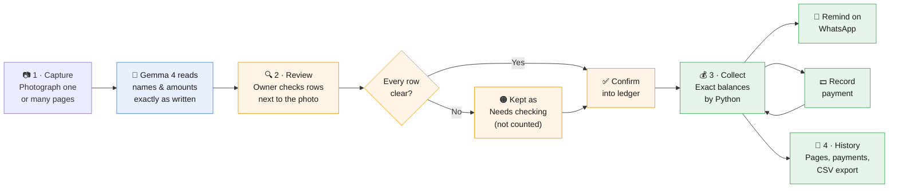
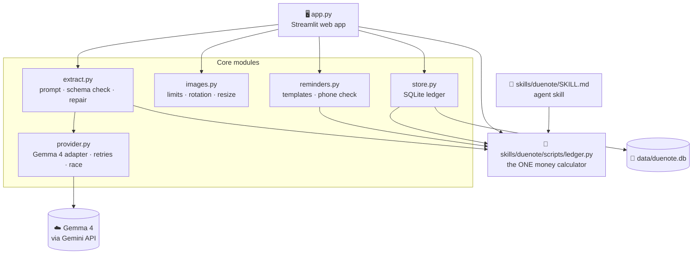

<div align="center">

# 📒 DueNote

### Turn a paper *khata* into a checked ledger and respectful WhatsApp reminders

[](https://github.com/Furiousgamer069/Duenote/actions/workflows/tests.yml)
-4285F4)


**Built at Hacktoberfest Hack Day Faisalabad × Himmatkaar**

[How it works](#-how-it-works) · [Quick start](#-quick-start) · [Architecture](docs/ARCHITECTURE.md) · [Pitch](PITCH.md) · [Demo script](DEMO_SCRIPT.md)

</div>

---

## 🧾 The problem

Every general store in Pakistan runs on a **khata**, a notebook of who took goods on credit (*udhaar*).

| 😟 Today | ✅ With DueNote |
|---|---|
| Totals added by hand; crossed-out numbers cause mistakes | **Python calculates every rupee** exactly |
| No quick answer to "who owes me the most?" | A clear list of **who owes what**, biggest first |
| Asking a regular customer for money feels rude, so it often doesn't happen | A **polite Urdu WhatsApp reminder**, ready in one tap |
| Switching to an app means changing habits | **Keep the notebook.** Just take a photo |

---

## 🔄 How it works



<sub>🔵 AI &nbsp;·&nbsp; 🟠 Shop owner decides &nbsp;·&nbsp; 🟢 Python code</sub>

### Who does what

| | Job | Why |
|---|---|---|
| 🤖 **Gemma 4** | Reads the photo and copies each row: name, date, details, amount, owed or paid | Understands images, Urdu and Roman Urdu |
| 🐍 **Python** | Checks every amount, adds up every balance, writes the reminder text | Exact maths with `Decimal`; it can't invent numbers |
| 🧑‍💼 **Owner** | Checks rows, confirms pages, approves name merges, presses **Send** | Stays in control of their money and their customers |

---

## ✨ Features

<table>
<tr><td width="50%" valign="top">

**📷 Capture**
- Upload **one or many photos** (up to 10) or use the camera
- **Read all** pages with live Gemma 4, with progress for each page
- 🧪 **Sample replay**: verified demo pages, no key or internet needed
- Handles sideways phone photos, corrupt files and size limits

**🔍 Review**
- Photo and rows side by side; edit any cell
- Compares the page's **written totals** with Python's maths
- Unclear amounts are flagged 🟠, **never counted as zero**
- Confirm moves you straight to the next uploaded page

</td><td width="50%" valign="top">

**💰 Collect**
- Customer states: 🔴 Due · ⏰ Overdue · 🟢 Settled · 🔵 Credit · 🟠 Needs checking
- **Record payment** (double-tap safe) and fix pending rows
- **Save each customer's WhatsApp number** (`03…`, `+92…`)
- Urdu / Roman Urdu reminder that **rewrites itself when the balance changes**

**📜 History**
- Every confirmed page, payment and fix, with timestamps
- Transaction and summary **CSV exports** (safe to open in Excel)
- Demo mode (temporary) or My shop mode (saved on this computer)

</td></tr>
</table>

---

## 🛡️ Built to be trusted

> **1. The AI only reads. Python does the maths.**
> Every rupee is parsed and added with exact decimals: `1,150`, `۱۲۵۰`, `1,50,000`, `Rs. 3,550` and `2400/-` all work.
>
> **2. Unknown is never zero.**
> Smudged, crossed-out, negative or missing amounts stay 🟠 *Needs checking*. They're left out of every total and get no reminder until the owner fixes them.
>
> **3. Reminders can't go stale.**
> A reminder is tied to the exact ledger version. A payment, an edit or a new shop name rewrites it straight away.
>
> **4. The owner decides.**
> Names are never merged automatically (`عثمان` ≠ `Usman` unless the owner says so), and WhatsApp only opens. The owner presses **Send**.

---

## 🚀 Quick start

```bash
git clone https://github.com/Furiousgamer069/Duenote.git
cd Duenote
python -m venv .venv
.venv\Scripts\activate          # macOS/Linux: source .venv/bin/activate
pip install -r requirements.txt
streamlit run app.py
```

Open **http://localhost:8501**. On a phone on the same Wi-Fi, use the *Network URL* that Streamlit prints.

| Mode | How | Needs |
|---|---|---|
| 🧪 **Sample replay** | *Sample replay* → *Replay verified transcription* | Nothing: no key, no internet |
| 🤖 **Live AI** | Copy `.env.example` to `.env`, add a free key from [Google AI Studio](https://aistudio.google.com/apikey), then *Read with Gemma 4* | Gemini API key + internet |

> ⏱ Live reads take about **1 minute per page**, longer when Google's servers are busy. For demos, use Sample replay.

---

## 📊 Results

**Acceptance checks** (automated, run on every push)

| Scenario | Expected | ✓ |
|---|---|---|
| Roman Urdu page: Usman 3,550 · Ali bhai 400 · Bilal 0 | **Rs. 3,950** in the app *and* the agent skill | ✅ |
| Urdu table: احمد علی · عائشہ · بلال خان · سارہ · عثمان | **Rs. 14,700**, matches the page's own total | ✅ |
| عثمان pays Rs. 1,000 | Balance 3,000 · total **Rs. 13,700** · reminder updated | ✅ |
| Same payment tapped twice | Recorded **once** | ✅ |

**Live Gemma 4 extraction** (measured 23 Oct 2026 on 2 sample pages)

| Page | Amounts correct | Balances correct | Time |
|---|---|---|---|
| Roman Urdu page | 6 / 6 | 3 / 3 | 55 s |
| Urdu summary table | 9 / 9 | 5 / 5 | 66 s *(was 180 s before speed work)* |

<sub>Two pages is a small sample, so these numbers show the method, not general accuracy. Reproduce with `python eval/run_eval.py`. Speed came from a direct-answer prompt (Gemma's hidden thinking dropped ~40%), asking both Gemma 4 models at once, and caching reads.</sub>

---

## 🧱 Architecture at a glance



➡️ Full diagrams (the live AI read sequence, customer states, how reminders stay current, and the data model) are in **[docs/ARCHITECTURE.md](docs/ARCHITECTURE.md)**.

---

## 🧪 Tests

```bash
python -m pytest -q        # 93 tests, no API key or internet needed
```

They cover money parsing (Urdu/Arabic digits, lakh commas, decimals, bad input), acceptance totals, payments and overpayments, double taps, multi-page review, aliases, stale-reminder prevention, phone formats, malformed AI output, simulated API failures (401/403/404/429/5xx), corrupt uploads, CSV formula safety and session isolation. GitHub Actions runs them on every push.

Live model check (uses your key): `python live_smoke_check.py`

---

## 🧩 Agent skill

[`skills/duenote/SKILL.md`](skills/duenote/SKILL.md) teaches any skill-compatible AI agent the same workflow, using the **same calculator** as the app:

```bash
python skills/duenote/scripts/balances.py skills/duenote/scripts/example_entries.json
```

---

## 🔒 Privacy

- **Demo mode** keeps data only in this browser session.
- **My shop mode** saves to `data/duenote.db` on *this computer* (never uploaded to Git). It's a single-user prototype with no login, so don't host it publicly with real data.
- Live AI sends the photo to Google's Gemini API. DueNote doesn't log notebook contents or keys.

---

## 📍 Status

| | |
|---|---|
| ✅ **Implemented** | Multi-page capture, review and confirm, exact ledger, pending rows, payments, saved WhatsApp numbers, self-updating reminders, overdue labels, history and exports, agent skill, 93 tests, CI |
| 🔁 **Replayed** | Sample replay uses verified transcriptions. No AI runs in that mode |
| 📏 **Measured** | Live extraction on 2 sample pages (above). No user testing yet |
| 🔜 **Planned** | Testing on real shop notebooks, per-row photo crops, login for multi-user hosting, voice notes |

**Known limitations:** small evaluation set (one page is synthetic) · live reads depend on Google's free servers · automatic name suggestions only work within one script · local single-user prototype.

---

<div align="center">

**Shopkeepers keep their notebook. DueNote helps them get paid.**

MIT License

</div>
