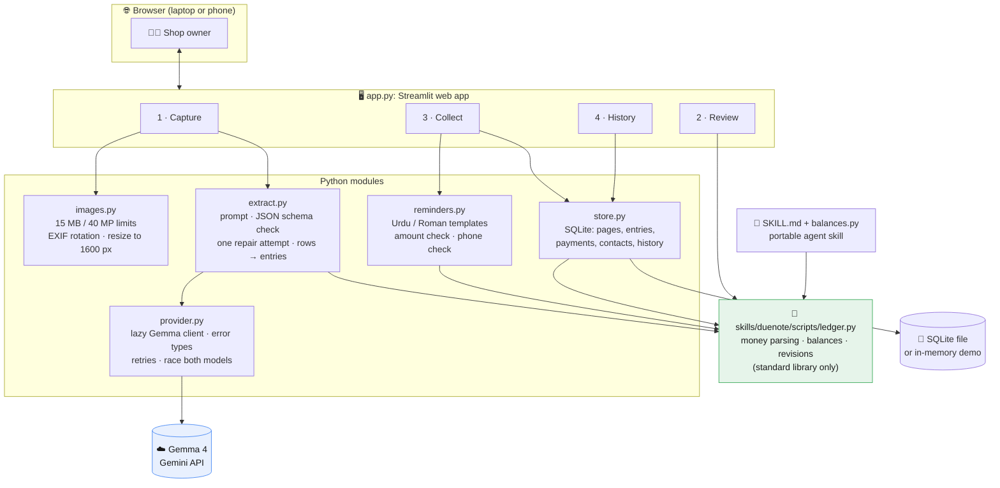
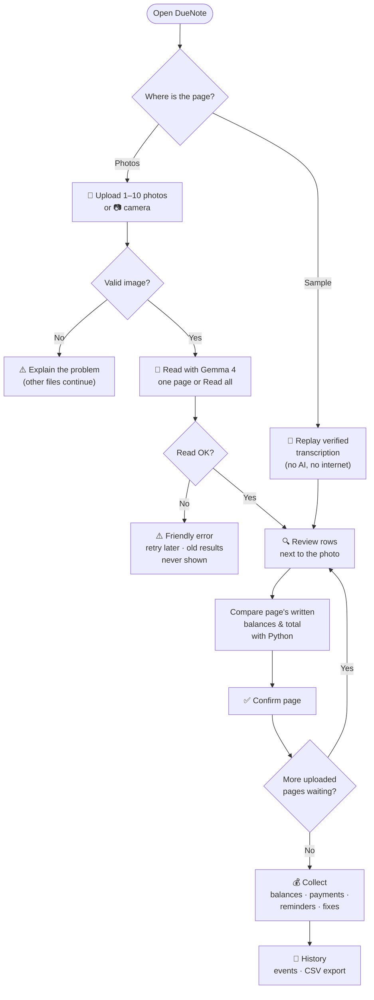
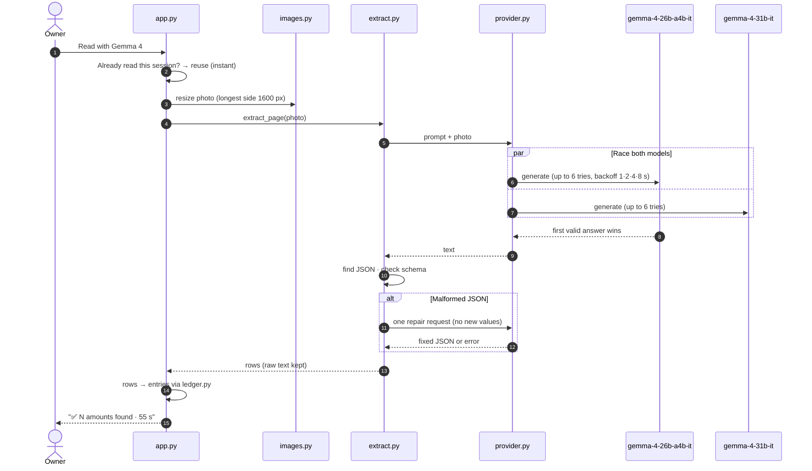
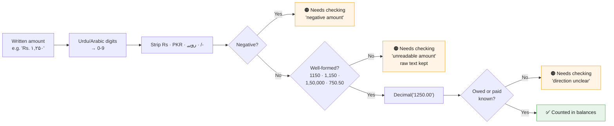
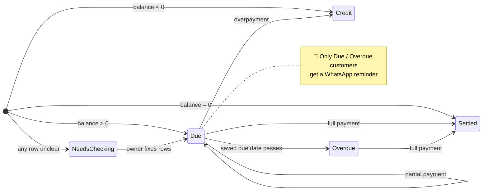
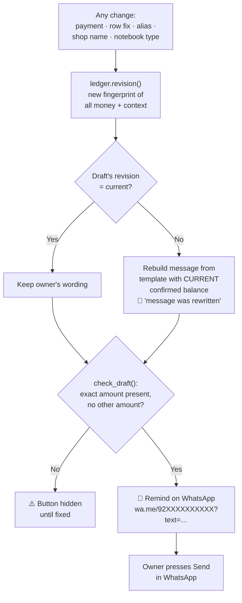
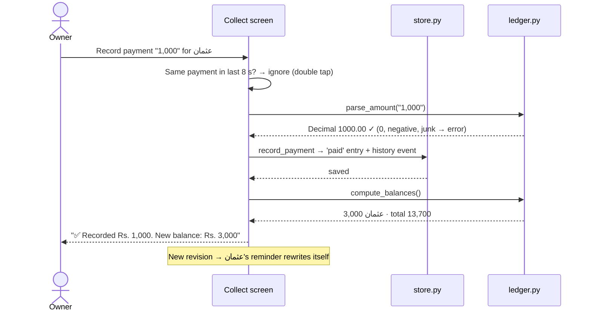
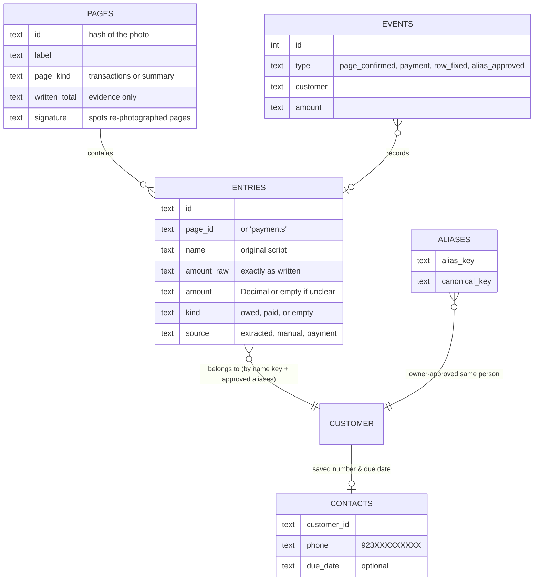

# 🧱 DueNote architecture

How DueNote works under the hood, with one diagram per idea.

**Contents:** [1. Module map](#1-module-map) · [2. The four steps](#2-the-four-steps) · [3. Reading a page with Gemma 4](#3-reading-a-page-with-gemma-4) · [4. From a written amount to a counted rupee](#4-from-a-written-amount-to-a-counted-rupee) · [5. Customer states](#5-customer-states) · [6. Why reminders never go stale](#6-why-reminders-never-go-stale) · [7. Recording a payment](#7-recording-a-payment) · [8. Data model](#8-data-model) · [9. Design decisions](#9-design-decisions)

---

## 1. Module map

**Key idea:** `ledger.py` is the **only** place money is calculated. The app, the database layer and the agent skill all use it, so they can never disagree.

---

## 2. The four steps

You can always move between steps with **← Back / Next →**. Confirming never gets stuck: unclear rows are stored as *Needs checking* and fixed later in Collect.

---

## 3. Reading a page with Gemma 4

| Failure | What the owner sees |
|---|---|
| No API key | "No Gemini API key… or use Sample replay" |
| 401 / 403 | "The API key was rejected" |
| 429 | "Too many requests, wait a minute" |
| 5xx / busy | Retried automatically on both models, then "Google's servers are busy" |
| Bad JSON twice | "Model output was not valid JSON", with nothing half-saved |

**Speed note:** the photo costs only ~620 tokens. Time goes on Gemma's hidden thinking, which the API won't let us switch off for Gemma, so the prompt says *"simple copying task, answer directly"*. In our measurement that cut thinking ~40% (Urdu page 180 s → 66 s together with racing).

---

## 4. From a written amount to a counted rupee

Written **remaining balances** and **page totals** never become debts. They're only compared with Python's result, and any difference is shown as a warning.

---

## 5. Customer states

| State | Badge | Reminder? |
|---|---|---|
| Needs checking | 🟠 | ❌ (unlocks after fixing) |
| Due | 🔴 | ✅ |
| Overdue | ⏰ | ✅ (only with a saved, passed due date) |
| Settled | 🟢 | ❌ |
| Credit | 🔵 | ❌ |

---

## 6. Why reminders never go stale

Phone numbers are normalized before saving: `0300 1234567`, `+92 300 1234567`, `0092-300-1234567` and Urdu digits all become `923001234567`. Anything else is rejected with a helpful message.

---

## 7. Recording a payment

---

## 8. Data model

Customers aren't a separate table: a customer is **the exact name key** (Unicode-normalized, case-folded), plus any aliases the owner approved. `عثمان` and `Usman` are different people until the owner says otherwise.

---

## 9. Design decisions

| Decision | Why |
|---|---|
| **Streamlit web app** | Runs in any browser, including phones on the same Wi-Fi, with no app install. Fast to build in a hackathon |
| **AI transcribes, Python calculates** | Language models can make arithmetic slips; `Decimal` doesn't |
| **Unknown is never zero** | A silent zero means asking a customer for the wrong amount |
| **Original-script identity** | Transliterations vary (*Aisha* / *Ayesha*); the written name doesn't |
| **Revision-bound reminders** | Makes it impossible to send an outdated amount |
| **Sample replay mode** | A reliable demo that doesn't depend on Google's free servers, clearly labelled as replay |
| **Race two Gemma 4 models** | Busy-server errors often hit one model but not the other |
| **SQLite, single user** | Enough for one shop's laptop; a public version would need logins first |
